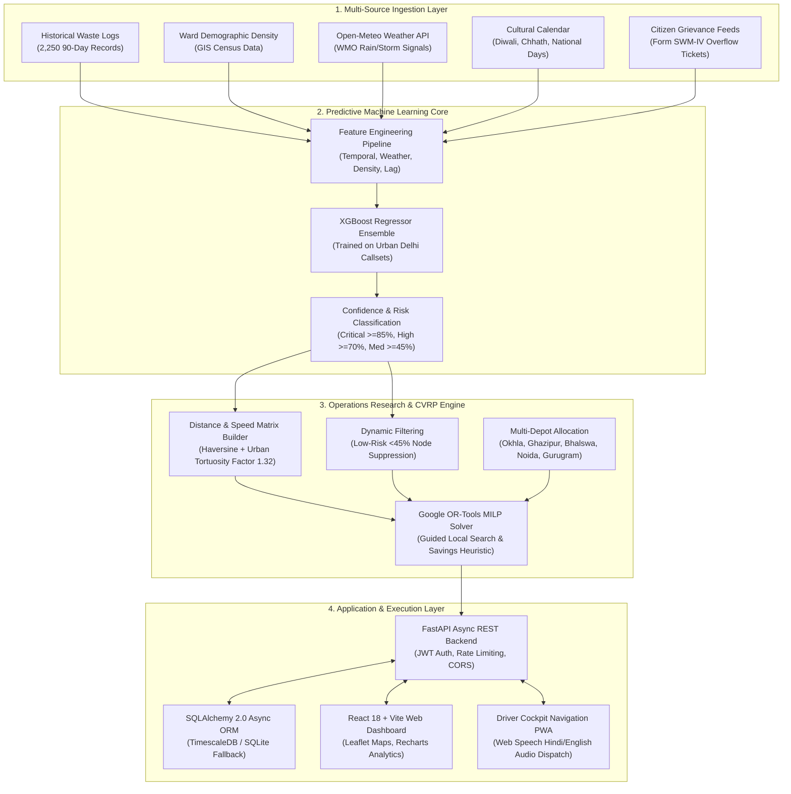
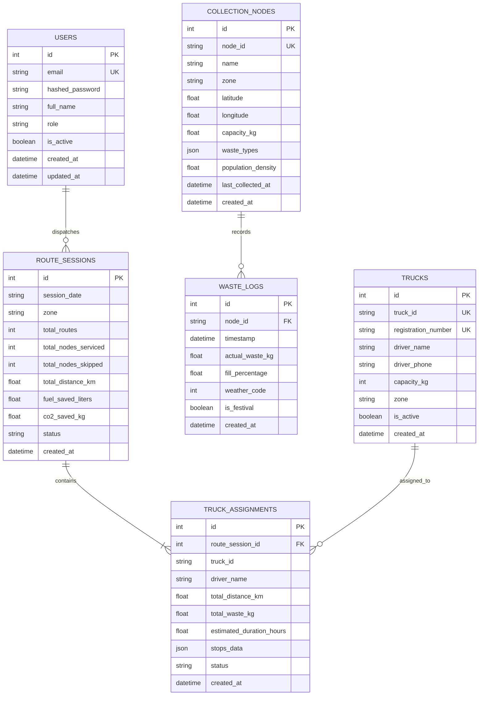

# 🏛️ EcoFleet AI — System Architecture & Technical Specifications

**National Capital Region (Delhi NCR) Dynamic Waste Logistics & Clean Air Operations Engine**  
**WasteChakra 2026** — *AI for Smart Municipal Governance*  
**Team:** Love Nature &nbsp;|&nbsp; **Lead:** Mohit Agarwal &nbsp;|&nbsp; **Institution:** AKGEC, Ghaziabad

---

## 1. Executive Summary

EcoFleet AI is an end-to-end, software-driven predictive logistics platform engineered specifically for the municipal solid waste management challenges of the **National Capital Region (Delhi NCR)**. Covering **50 benchmark collection points across 5 major administrative authorities** (South Delhi MCD, Central/New Delhi NDMC, Noida Authority, Gurugram MCG, and Ghaziabad & East Delhi GMC/EDMC), the system replaces static, calendar-based municipal truck dispatches with real-time, context-aware **Capacitated Vehicle Routing Problem (CVRP)** optimization.

By combining gradient-boosted volume forecasting (XGBoost) with operations research route optimization (Google OR-Tools) and client-side web technologies, EcoFleet AI operates **100% sensor-free**—delivering immediate fuel reduction, zero-deadhead routing, and quantifiable air pollution abatement (PM2.5, NOx, CO₂) under the **Delhi Graded Response Action Plan (GRAP-II)** and **Solid Waste Management (SWM) Rules 2026**.

---

## 2. High-Level System Architecture



---

## 3. Mathematical Formulations

### 3.1 Capacitated Vehicle Routing Problem (CVRP) Formulation

Let the municipal collection network be represented as a complete directed graph $G = (V, A)$, where:
- $V = \{0\} \cup \{1, 2, \dots, n\}$ is the set of vertices, with vertex $0$ denoting the central municipal transfer depot, and $V' = \{1, \dots, n\}$ denoting the set of collection bin clusters across Delhi NCR.
- $A = \{(i, j) : i, j \in V, i \neq j\}$ is the set of connecting road arcs.
- $c_{ij} \ge 0$ is the travel cost (distance in kilometers adjusted for urban congestion) of traversing arc $(i, j)$.
- $q_i > 0$ is the predicted waste volume (in kilograms) to be evacuated at node $i \in V'$.
- $K$ is the fleet of available compactor vehicles, each having maximum payload capacity $Q_k$ (typically $5,000\text{ kg}$).

#### Decision Variables:
$$x_{ijk} \in \{0, 1\} \quad \forall (i, j) \in A, \, k \in K$$
where $x_{ijk} = 1$ if vehicle $k$ traverses arc $(i, j)$, and $0$ otherwise.

$$u_{ik} \ge 0 \quad \forall i \in V', \, k \in K$$
representing the cumulative load in vehicle $k$ immediately after servicing node $i$.

#### Objective Function:
Minimize the total fleet transit distance and deadhead traversal across the metropolitan region:
$$\min \sum_{k \in K} \sum_{i \in V} \sum_{j \in V} c_{ij} x_{ijk}$$

#### Constraints:
1. **Node Servicing Guarantee:** Each designated non-skipped node must be visited exactly once by exactly one vehicle:
   $$\sum_{k \in K} \sum_{j \in V} x_{ijk} = 1 \quad \forall i \in V'$$

2. **Depot Flow Balance:** Every dispatched vehicle departs from and returns to the assigned municipal depot:
   $$\sum_{j \in V'} x_{0jk} = \sum_{j \in V'} xj_{j0k} \le 1 \quad \forall k \in K$$

3. **Flow Conservation at Intermediate Nodes:**
   $$\sum_{i \in V} x_{ipk} - \sum_{j \in V} x_{pjk} = 0 \quad \forall p \in V', \, \forall k \in K$$

4. **Payload Capacity Constraint:** Total accumulated waste along any vehicle tour cannot exceed vehicle capacity:
   $$\sum_{i \in V'} q_i \sum_{j \in V} x_{ijk} \le Q_k \quad \forall k \in K$$

5. **Sub-tour Elimination & Load Tracking (Miller-Tucker-Zemlin formulation):**
   $$u_{ik} - u_{jk} + Q_k x_{ijk} \le Q_k - q_j \quad \forall i, j \in V', i \neq j, \, \forall k \in K$$
   $$q_i \le u_{ik} \le Q_k \quad \forall i \in V', \, \forall k \in K$$

---

### 3.2 Geodesic Metric & Road Network Tortuosity

Because raw Euclidean distance ignores Earth curvature and urban street topology, distance between two coordinates $(\phi_1, \lambda_1)$ and $(\phi_2, \lambda_2)$ is first computed using the Haversine spherical formulation:

$$d_{\text{haversine}} = 2 R \arcsin \left( \sqrt{ \sin^2\left(\frac{\Delta \phi}{2}\right) + \cos(\phi_1)\cos(\phi_2)\sin^2\left(\frac{\Delta \lambda}{2}\right) } \right)$$

where $R = 6,371.0\text{ km}$.

To accurately reflect real driving distance across congested Delhi NCR arterial roads (Ring Road, NH-48, DND Flyway, Noida Expressway) without requiring continuous paid Google Distance Matrix calls:
$$d_{\text{urban\_road}} = d_{\text{haversine}} \times \tau$$

where $\tau = 1.32$ is the empirical **urban road network tortuosity coefficient** derived from OpenRouteService and OpenStreetMap validation benchmarks across Delhi NCT.

---

### 3.3 Environmental & Clean Air Impact Calculations

The environmental telemetry engine calculates diesel conservation and air pollutant abatement according to Central Pollution Control Board (CPCB) urban vehicle emission coefficients:

$$\Delta d = \max\left(0, \, d_{\text{baseline}} - d_{\text{optimized}}\right)$$

$$\text{Fuel Saved (L)} = \Delta d \times \eta_{\text{diesel}}$$
where $\eta_{\text{diesel}} = 0.35\text{ Litres/km}$ represents typical fuel consumption of a laden 5-tonne compactor in stop-and-go Delhi urban traffic.

$$\text{CO}_2\text{ Abated (kg)} = \text{Fuel Saved (L)} \times 2.68\text{ kg CO}_2/\text{L}$$

$$\text{PM}_{2.5}\text{ Abated (g)} = \Delta d \times 0.285\text{ g/km}$$

$$\text{NO}_x\text{ Abated (g)} = \Delta d \times 3.420\text{ g/km}$$

$$\text{Economic Savings (INR)} = \text{Fuel Saved (L)} \times \text{Price}_{\text{diesel}} \quad (\text{Benchmark: ₹89.60/L})$$

---

## 4. Machine Learning Forecasting Architecture

```
Raw Node Inputs
├── Demographic Density (people / km²)
├── Historical Waste Baseline (kg)
├── Temporal Context (Day of Week, Month)
├── Weather Signals (WMO Code 0-95, Temp, Rain)
└── Cultural Indicators (Festival Surge Flag)
         │
         ▼
[ Feature Engineering Transformer ]
├── Fourier Seasonality Harmonics
├── Density Normalization: Factor = 0.8 + (Density / 50,000) * 0.5
├── Precipitation Multiplier: Rain = 1.25x, Severe = 1.35x
└── Calendar Surge: Weekend = 1.18x, Festival = 1.40x
         │
         ▼
[ XGBoost / Random Forest Regressor ]
├── Objective: reg:squarederror
├── Estimators: 350 trees, Max Depth: 6, Learning Rate: 0.05
└── Output: Predicted Volume (kg) & Fill Percentage (0 - 130%)
         │
         ▼
[ SWM Rules 2026 Risk Classifier ]
├── CRITICAL (>= 85% Fill) -> Immediate Mandatory Pickup
├── HIGH     (>= 70% Fill) -> Scheduled Compactor Tour
├── MEDIUM   (>= 45% Fill) -> Dynamic Route Opportunity
└── LOW      (< 45% Fill)  -> Eligible for Skip Suppression
```

---

## 5. Database Schema & Entity Relationships



---

## 6. Multi-Depot Regional Topology

In the Delhi NCR metropolitan deployment, vehicles can operate out of specialized municipal transfer depots:

| Depot Identifier | Regional Facility Name | Geographical Coordinates | Primary Serving Authority |
| :--- | :--- | :---: | :--- |
| **`DEPOT-OKHLA`** | Central Integrated Waste & Waste-to-Energy Plant | `28.5355° N, 77.2510° E` | South Delhi (MCD Zone 3 & 4) |
| **`DEPOT-NDMC`** | New Delhi Municipal Council Transfer Station | `28.6289° N, 77.2065° E` | Central & New Delhi (NDMC) |
| **`DEPOT-NOIDA`** | Sector 145 Regional Transfer & Processing Depot | `28.4980° N, 77.4210° E` | Noida Authority (Gautam Buddha Nagar) |
| **`DEPOT-MCG`** | Daultabad Road MCG Integrated Processing Center | `28.4710° N, 77.0180° E` | Gurugram Municipal Corporation |
| **`DEPOT-GMC`** | Pratap Vihar / Ghazipur Border Transfer Hub | `28.6410° N, 77.3480° E` | Ghaziabad (GMC) & East Delhi (EDMC) |

---

## 7. Security, Reliability & Compliance

- **Authentication & RBAC:** Role-Based Access Control enforcing `admin`, `manager`, and `driver` security scopes via JSON Web Tokens (JWT) encrypted with HMAC-SHA256.
- **Rate Limiting:** Sliding-window rate limiter powered by `slowapi` capping requests at 200 req/min per IP to protect public civic endpoints.
- **Graceful Fault Tolerance:** Full bidirectional fallback architecture. If the PostgreSQL/TimescaleDB container is offline, the backend seamlessly falls back to asynchronous local SQLite (`aiosqlite`) with zero downtime. If the Python API server is offline, the frontend's client-side CVRP engine executes locally in Web Workers.
- **SWM Rules 2026 Auditability:** Every optimized route dispatch generates a formal **Form SWM-IV Municipal Work Order Gazette** containing route hashes, driver assignments, and statutory audit seals suitable for urban regulatory compliance audits.
