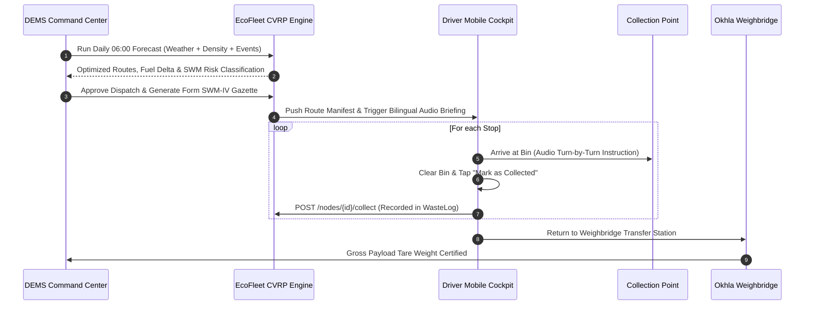

# 📋 EcoFleet AI — Municipal Operations Standard Operating Procedure (SOP)

**Jurisdiction:** National Capital Region Municipal Alliance (Delhi NCR)  
**Governing Mandate:** Solid Waste Management (SWM) Rules 2026 & Swachh Bharat Mission (Urban) 2.0  
**Division:** Department of Environment Management Services (DEMS) & Zonal Health Office (ZHO)  
**Form Standard:** Gazette Form SWM-IV (Daily Vehicle Dispatch & Manifest Log)

---

## 1. Operational Scope & Jurisdictional Coverage

This manual outlines standard operating protocols for DEMS Executive Engineers, Zonal Sanitary Inspectors (SI), Vehicle Fleet Dispatchers, and Compactor Operators managing waste evacuation across the **50 primary collection hubs in Delhi NCR**:

1. **South Delhi (MCD Zone 3 & 4):** 15 Hubs · Primary Depots: Okhla Integrated Solid Waste Facility & Tehkhand
2. **Central & New Delhi (NDMC):** 9 Hubs · Primary Depot: Mandir Marg / Connaught Place Station
3. **Noida Authority (UP):** 9 Hubs · Primary Depot: Sector 145 Regional Processing Facility
4. **Gurugram (MCG, Haryana):** 9 Hubs · Primary Depot: Daultabad Road Center & Bandhwari WtE
5. **Ghaziabad & East Delhi (GMC/EDMC):** 8 Hubs · Primary Depot: Ghazipur / Pratap Vihar Transfer Depot

---

## 2. Municipal Daily Duty Shift Schedules

Municipal logistics operate on a staggered two-shift cycle to minimize intersection with peak morning school and office traffic along major NCR arterial expressways:

| Shift Designation | Operational Hours | Primary Objective | Typical Vehicle Pool |
| :--- | :---: | :--- | :--- |
| **Shift 1: Morning Compactor Run** | **06:00 – 14:00 hrs** | Commercial & Wholesale Market Evacuation (Lajpat Nagar, CP, Sadar Bazar, Atta Market) | Heavy CNG Compactors (5.5T) & High-Capacity EVs |
| **Shift 2: Afternoon Secondary Run** | **14:00 – 22:00 hrs** | Residential Enclaves, Hospital Bins, and Dynamic Citizen Grievance Hotspots | Electric Tippers (3.5T - 4.5T) & Light Compactors |

---

## 3. Workflow Lifecycle: From Prediction to Disposal

---

## 4. Driver Cockpit & Native Audio Dispatch Protocol

EcoFleet AI features a native **Bilingual Voice Guidance System** (Hindi / English) integrated directly into the Driver Cockpit Terminal via the browser's Web Speech API:

### 4.1 Shift Briefing Voice Prompt
Upon initial dispatch, the driver terminal speaks the high-level duty summary:
- **English:** *"Good morning Driver. Your EcoFleet dispatch manifest is ready. You have 7 collection stops assigned. Total estimated waste volume is 4,200 kilograms. Your first stop is Lajpat Nagar Central Market."*
- **Hindi:** *"नमस्ते चालक जी। आपकी इको-फ्लीट ड्यूटी तैयार है। आपके रूट पर 7 कूड़ा संग्रह केंद्र हैं। कुल अनुमानित कचरा 4,200 किलोग्राम है। आपका पहला स्टॉप लाजपत नगर सेंट्रल मार्केट है।"*

### 4.2 Turn-by-Turn Next Stop Guidance
As each stop is marked complete, the driver receives real-time spoken navigation instructions:
- **Spoken Text:** *"Next stop is Node NODE-004, Nehru Place Commercial Hub. Risk level is Critical at 92% capacity. Please proceed via Outer Ring Road."*

---

## 5. Citizen Grievance & Incident Priority Elevation

Under SWM Rules 2026, citizen complaints submitted via the public grievance portal require a time-bound municipal response:

1. **Submission:** Citizen logs an overflow incident with landmark, photos, and estimated overflow weight.
2. **Immediate Queueing:** The ticket is assigned a unique alphanumeric code (e.g. `TICKET-MCD-2026-0891`) and persisted in the active database.
3. **Dynamic Re-Routing:** 
   - If fill percentage exceeds **85%**, the node status changes to **CRITICAL**.
   - If an active truck in the same zone has unallocated payload capacity, the CVRP solver dynamically re-sequences the tour to service the grievance before returning to depot.
   - Once collected, the ticket is marked **RESOLVED** and an audit timestamp is stamped on the manifest.

---

## 6. Official MCD Form SWM-IV Gazette Protocol

Every morning at 05:45 hrs, the DEMS Fleet In-Charge must generate and certify the **Form SWM-IV Municipal Work Order Gazette**:

### Statutory Gazette Inclusions:
- **Emblem & Seal:** Municipal Corporation of Delhi emblem and SWM 2026 certification stamp.
- **Gazette Reference:** E.g. `NCR/DEMS/2026/WO-0892`.
- **Vehicle Allocation Matrix:** Truck registration numbers (DL, UP, HR), assigned drivers, mobile contacts, fuel types, allocated waste weight, and route distances.
- **Environmental Certification:** Certified liters of diesel conserved, deadhead kilometers avoided, and calculated carbon abatement.
- **Official Signatures:**
  1. Executive Engineer (Fleet Logistics & Operations)
  2. Zonal Health Officer (ZHO)
  3. Driver Receipt & Vehicle Inspection Acknowledgment

---

## 7. Emergency & Offline Contingency Measures

- **No Cellular Network / Offline Mode:** The Driver Cockpit uses Progressive Web App (PWA) client-side storage (`localStorage` & IndexedDB). Drivers can continue logging collections offline; logs will automatically synchronize with the central API when connectivity is restored.
- **Vehicle Mechanical Breakdown:** The dispatcher navigates to `/fleet`, marks the truck as **Maintenance**, and re-triggers CVRP. The remaining unserviced stops are instantly distributed across the remaining active fleet vehicles without manual intervention.
